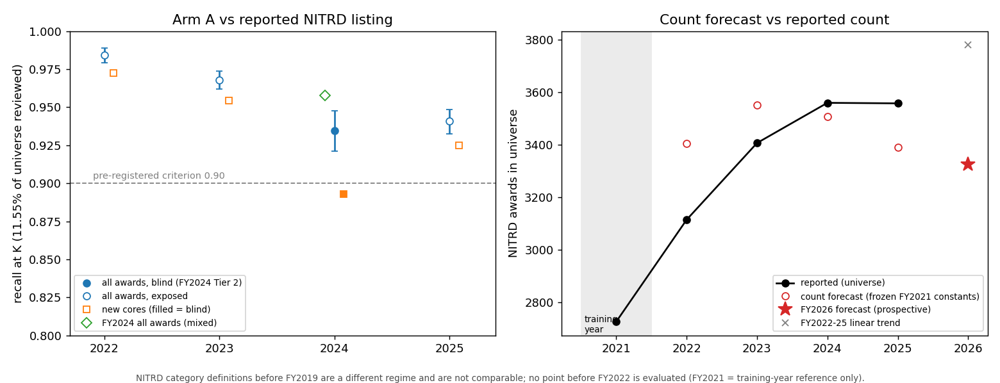

# Performance vs reported NITRD data (Task 1, arm A)

Backtest `task1-backtest-vs-reported-v1`: `tools/backtest_vs_reported_v1.py` writes
`build/task1_backtest_vs_reported_v1/report.json` and `performance_vs_reported.png`. This is evaluation code. It does not
run under the build guard, and none of its output feeds a model. The sealed volume is not opened. FY2024 values are read
from the committed one-shot score report (`build/task1_fy2024_score_v1/report.json`, `2fc574fe...`).

The frozen fingerprint is applied unchanged to each year (`task1-fingerprint-v1`, TF-IDF + logistic regression, model
`b703083d...`, fitted on FY2019-FY2021 text and FY2021 labels). The **reported listing** is RePORTER's per-award
membership in spending category 329 (NITRD), within the reconstructed universe (`task1-universe-qvr-recon-v1`). The
operating point is a shortlist of the top 11.55% of each year's universe, the fraction calibrated on FY2021 for 0.95
recall.

## High-recall triage, by year

| FY | Blind? | Universe | Shortlist K | Reported NITRD | Recall at K [95% CI] | New-core recall (n) | Precision |
| --- | --- | --- | --- | --- | --- | --- | --- |
| 2022 | exposed (labels read 2026-10-25) | 64,313 | 7,428 | 3,115 | 0.984 [0.979, 0.989] | 0.972 (1,018) | 0.445 |
| 2023 | exposed (labels read 2026-10-25) | 65,369 | 7,550 | 3,407 | 0.968 [0.962, 0.974] | 0.954 (939) | 0.469 |
| 2024 | **blind**: Tier 2, non-File-A | 61,423 of 64,065 | 7,399 | 1,479 | **0.934 [0.921, 0.948]** | 0.893 (364) | 0.287 |
| 2024 | mixed: all awards (blind Tier 2 + exposed File A) | 64,065 | 7,399 | 3,560 | 0.958 | n/a | n/a |
| 2025 | exposed (FY2025 NITRD awards read by Task 2, 2026-10) | 58,686 | 6,778 | 3,558 | 0.941 [0.932, 0.949] | 0.925 (890) | 0.522 |

* At about 12% review burden, the shortlist captures 93-98% of the awards RePORTER lists as NITRD in every year from
  FY2022 to FY2025. It stays at or above the pre-registered 0.90 recall criterion. Only FY2024 Tier 2 is a blind test of
  that criterion, and it passes.
* **New cores** are cores with no NIH record in the three prior fiscal years, so neither carry-forward nor any prior
  label can find them. Recall on new cores is 0.97, 0.95, 0.89 (blind) and 0.93 for FY2022-FY2025. Carry-forward
  recall on new cores is 0 by construction.
* **Decay:** all-award recall moves from 0.984 to 0.968, then 0.958 (FY2024, mixed), then 0.941. That is about 1.4 points
  a year, three to four years after the FY2021 training year. The blind FY2024 Tier 2 value (0.934) is lower than the
  all-award values because Tier 2 excludes the File A (AI) awards, which the fingerprint finds most easily (recall 0.974).
* Precision is low: the shortlist is a review queue, not a classification. In blind Tier 2 it is also low because NITRD
  prevalence there is 2.4%. Primary precision leaves uncategorized awards (no RCDC category at all) out of the
  denominator; the report's sensitivity value counts them as not-NITRD.
* Cohen's κ against the listing is 0.58-0.64 in the exposed years and 0.42 in blind Tier 2. It is reported only as
  context. It is below the published 0.56 / 0.62 analogs in blind Tier 2, and it depends strongly on prevalence and on
  the shortlist size.

FY2022, FY2023 and FY2025 are **not blind**: their listings were read before this backtest. They describe how the frozen
model holds up over time, not whether the pre-registered criterion is met. The FY2022 and FY2023 values match the Tier 3
report (`build/task1_tier3_v1`) exactly; they were recomputed here independently.

## Count forecast vs reported count

The pre-registered count forecast, (1 - u2021) x r2021 x sum of scores, is applied to each year with the frozen FY2021
constants: u2021 = 0.0735 (recomputed exactly from the FY2021 seed) and r2021 = 1.230.

| FY | Reported NITRD (universe) | Prevalence | Forecast | Error |
| --- | --- | --- | --- | --- |
| 2021 (training year, reference) | 2,727 | 4.32% | n/a | n/a |
| 2022 | 3,115 | 4.84% | 3,405 | +9.3% |
| 2023 | 3,407 | 5.21% | 3,551 | +4.2% |
| 2024 | 3,560 | 5.56% | 3,508 | -1.5% |
| 2025 | 3,558 | 6.06% | 3,391 | -4.7% |
| 2026 | not yet public (0 FY2026 records as of 2026-11-05) | forecast 5.89% | **3,326** | scored at Tier 1 |

* Reported prevalence has risen every year since FY2021. The forecast's error moves from over-prediction (FY2022) to
  under-prediction (FY2025). The forecast is anchored to FY2021, so it follows the text but not the growth in labelling.
* The FY2026 forecast is 3,326 on a 56,508-award snapshot, a prevalence of 5.89%. That is below FY2025's reported 6.06%.
  A straight line through the FY2022-2025 counts gives 3,781, 12% above the forecast. That line ignores the smaller
  FY2026 snapshot (the year is not complete), so prevalence is the fairer comparison. On the FY2022-FY2025 pattern, the
  forecast is more likely to be low than high. It is scored once, against the filtered FY2026 count, at the Tier 1
  reveal.

## Scope and definition regime

NITRD category definitions before FY2019 are a different regime, and their counts are not comparable. This backtest
evaluates nothing before FY2022. FY2021 is the training year and appears only as the reference count.

## Reproduce

Run `python3 tools/backtest_vs_reported_v1.py`. It fetches FY2025 once, write-once to the volume, then scores and
writes. A second run into an existing output folder is refused. Re-running from the same inputs reproduced `report.json` byte for byte
(checked before the prevalence fields were added), and the chart was byte-identical in all three runs. Every input file and its SHA-256 is listed in `READ_MANIFEST.json`.
